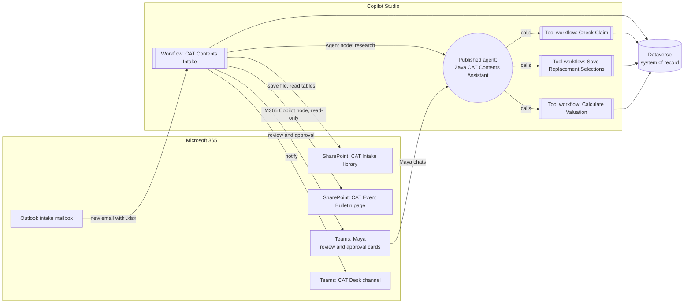

# Demo architecture

One process, two entry points: a **workflow that calls agents** and an **agent that calls workflows**, both reading and writing the same Dataverse records.

## Components

| Component | Type | Role in the demo | Status |
|---|---|---|---|
| CAT Contents Intake | Copilot Studio Workflow, connector-event trigger | Runs each claim end to end; calls AI nodes and agents; waits for review and approval | New |
| Zava CAT Contents Assistant | Published Copilot Studio agent | Replacement research when the workflow calls it; Maya's assistant in Teams, where it calls tool workflows | Reused, rebranded |
| Item Normalizer | Inline agent inside the workflow | Normalizes shorthand descriptions and assigns a category from a fixed list | New |
| Check Claim | Agent-called workflow (tool) | Returns the case, items, flags and latest valuation for a claim | Reused, extended |
| Save Replacement Selections | Agent-called workflow (tool) | Writes a confirmed replacement (URL, unit price, confidence) to an item | Reused, input changed to JSON text |
| Calculate Valuation | Agent-called workflow (tool) | Recalculates every item from the rule set and writes a new calculation run | Reused, logic fixed |
| Dataverse | Data | Cases, items, valuations, rules, approvals, audit trail | Reused; 2 columns and 4 choice labels added |
| CAT Event Bulletin | SharePoint page | Grounding for the M365 Copilot node | New |

## Why each step is deterministic, AI or human

| Step | Kind | Why |
|---|---|---|
| Trigger, save, read, create records | Deterministic | Input-to-output is known and cheap to code |
| Classification | AI | Emails vary; rules would be brittle |
| Item normalization | AI | Shorthand like "TV LG 47" needs interpretation |
| Replacement research | AI, published agent | Reasoning and tool use over retailer sites; an agent already does the job |
| Validation gate | Deterministic | Verify before trusting: counts, references, allowlisted retailer domains |
| Valuation | Deterministic | Money must be reproducible; the model never does the math |
| Bulletin guidance | AI, M365 Copilot, read-only | Built-in Microsoft 365 grounding; nothing is written |
| Flags and routing | Deterministic | Policy must be explicit and auditable |
| Review and approval | Human | The licensed adjuster decides |

## Dataverse touchpoints

The CCA solution export uses some doubled logical names, for example `cca_categorycca_category`. Pick columns by **display name** in the designer; use the logical names below only in OData filters or `$select`.

| Table (entity set) | Columns used: display name, logical name |
|---|---|
| Valuation Case (`cca_valuationcases`) | Case Name `cca_casename`, Claim ID `cca_claimid`, Insured Name `cca_insuredname`, Policy ID `cca_policyid`, Loss Date `cca_lossdate`, Province `cca_province` (text), CAT Code `cca_catcode`, Loss Type `cca_losstype`, Currency `cca_currency`, Case State `cca_casestate`, Case Version `cca_caseversion`, Assigned Adjuster `cca_assignedadjuster`, Data Classification `cca_dataclassification` |
| Inventory Item (`cca_inventoryitems`) | Item Name `cca_itemname`, Claim ID `cca_claimid`, Source Item Reference `cca_sourceitemreferencecca_sourceitemreferenc`, Room `cca_roomcca_room`, Item Description `cca_itemdescriptioncca_itemdescription`, Brand `cca_brandcca_brand`, Model `cca_modelcca_model`, Supplier or Retailer `cca_supplierorretailercca_supplier`, Quantity `cca_quantitycca_quantity`, Age Years `cca_ageyearscca_ageyears`, Age Months `cca_agemonthscca_agemonths`, Declared Cost `cca_declaredcostcca_declaredcost`, Item Notes `cca_itemnotescca_itemnotes`, Category `cca_categorycca_category`, Replacement Cost `cca_replacementcost` (unit price), Item Location `cca_itemlocationcca_location` (replacement URL), Disposition `cca_dispositioncca_disposition`, Original Record JSON `cca_originalrecordjsoncca_originalrecordjson`, **Replacement Confidence** `cca_replacementconfidence` (new), **Review Reason** `cca_reviewreason` (new) |
| Item Valuation (`cca_itemvaluations`) | Item Valuation Name, Claim ID, Source Item Reference, Inventory Item (lookup), Calculation Run (lookup), Depreciation Category, Depreciation Percent, Depreciation Amount, Replacement Value Each, Replacement Value Total, ACV Each, ACV Total, Calculated At |
| Calculation Run (`cca_calculationruns`) | Calculation Name `cca_calculationname`, RCV `cca_rcvcca_rcv`, Depreciation `cca_depreciationcca_depreciation`, ACV `cca_acvcca_acv`, Rule Set Version `cca_rulesetversioncca_rulesetversion`, Engine Version `cca_engineversioncca_engineversion`, Calculated At `cca_calculatedatcca_calculatedat` |
| Rule Set Version (`cca_rulesetversions`) | Rule Set Name `cca_rulesetname`, Rule Payload JSON `cca_rulepayloadjson`, Approval Status `cca_approvalstatus`, Effective Start, Effective End |
| Approval (`cca_approvals`) | Approval Name, Decision (Approve, Reject, Hold), Is Approved, Adjuster Identity, Decided At, Attestation, Rationale, Package Version ID |
| Case Issue (`cca_caseissues`) | Case Issue Name, Issue Code, Severity, Issue Status, Details |
| Command Ledger (`cca_commandledgers`) | Command Name, Command, Actor, Correlation ID, Outcome, Result JSON, Completed At. **Used as the audit trail**: the export has no Audit Event table. |

The export has no alternate keys, so the workflow checks for an existing claim with **List rows** before creating one.

## Connections

| Connection | Used by | Notes |
|---|---|---|
| Office 365 Outlook | Trigger | Demo mailbox; measure trigger latency in the Thursday spike |
| SharePoint | Save file | CAT Intake library |
| Excel Online (Business) | Read tables | Tables `ClaimHeader` and `Inventory`; set DateTime Format to ISO 8601 |
| Microsoft Dataverse | Record steps and the three tools | Tools run as the invoking user (Maya) |
| Copilot Studio agents (`MyAgentsConnection`) | Agent node | Calls the published Zava CAT Contents Assistant |
| Microsoft 365 Copilot (`My365CopilotConnection`) | M365 Copilot node | The connection's account needs a Microsoft 365 Copilot license |
| Approvals, Microsoft Teams | Review, approval, CAT Desk post | Create and consent to all connections before show day |

Keep all of these in one DLP business data group and block generic HTTP in the demo environment.

## Environment variables

| Display name (schema name) | Example | Used for |
|---|---|---|
| Adjuster email (`cca_AdjusterEmail`) | maya@contoso.onmicrosoft.com | Review and approval assignee; Assigned Adjuster |
| Intake library folder (`cca_IntakeFolder`) | /Shared Documents/CAT Intake | Where attachments are saved |
| Rule set name (`cca_RuleSetName`) | Zava Demo Depreciation Rules v1.0 | Which Rule Set Version row to load |
| CAT Desk team ID (`cca_CatDeskTeamId`) and channel ID (`cca_CatDeskChannelId`) | n/a | Teams post target |
