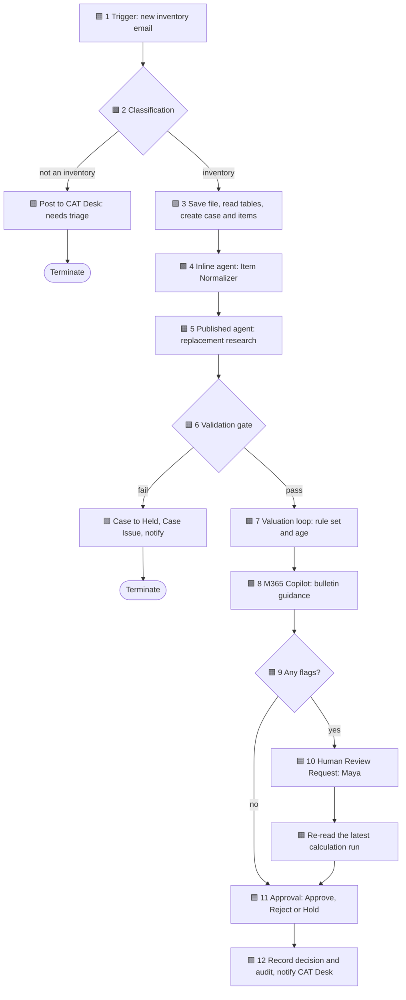

# CAT Contents Intake: workflow build spec

| | |
|---|---|
| Type | Copilot Studio Workflow |
| Trigger | Connector event: new email with an attachment |
| Runs as | The workflow owner's connections |
| Duration | Long-running: it waits for human review and approval |
| Naming convention | Every record name starts with the claim ID, for example `ZAV-1042 · intake`. The reset script relies on this. |

Colour key used in the talk: 🟩 deterministic, 🟪 AI, 🟦 human.

Exact expressions for every step are in [workflow/expressions.md](../workflow/expressions.md). Prompts are in [workflow/prompts](../workflow/prompts), card text in [workflow/cards](../workflow/cards), schemas in [contracts](../contracts).

## Variables

Initialize these at the top of the workflow.

| Name | Type | Initial value |
|---|---|---|
| `CorrelationId` | String | `guid()` |
| `AdjusterEmail` | String | Environment variable *Adjuster email* |
| `ClaimId`, `InsuredName`, `PolicyId`, `CaseId`, `CalcRunId`, `CalcRunName`, `BulletinNotes` | String | empty |
| `Rules` | Object | `{}`; set in step 7 |
| `ItemIndex` | Array | `[]`; one `{ref, itemId}` per created item |
| `Flags` | Array | `[]`; one `{ref, item, reason}` per flagged item |
| `GateFailed` | Boolean | `false` |
| `TotalRCV`, `TotalDep`, `TotalACV` | Float | `0` |
| `ItemsValued`, `SpecialistItems` | Integer | `0` |

## 1. Trigger 🟩

**Node:** Connector event, Office 365 Outlook, *When a new email arrives* in the demo intake mailbox.

| Setting | Value |
|---|---|
| Folder | Inbox |
| Only with attachments | Yes |
| Include attachments | Yes |
| Subject filter | `Contents inventory` |

**Demo note:** measure trigger latency in the Thursday spike. If a new email takes more than 60 seconds to start a run, keep the email story but start the live ZAV-1043 run earlier in the session, or switch to a SharePoint *file created* trigger.

## 2. Classification 🟪

**Node:** AI node, Classification.

| Setting | Value |
|---|---|
| Input | Subject, body preview and attachment names (expression E2.1) |
| Categories | `ContentsInventory`, `ProofOfPurchase`, `Other`, with the descriptions in [classification.md](../workflow/prompts/classification.md) |

**Branch:** add a deterministic check too: at least one `.xlsx` attachment (E2.2). If the category isn't `ContentsInventory` or there is no workbook:

1. Post to the CAT Desk channel: "Needs triage: *subject*, from *sender*."
2. **Terminate** with status Succeeded.

## 3. Save file, read tables, create case and items 🟩

1. **SharePoint, Create file** in the CAT Intake library. File name E3.1, content E3.2.
2. **Delay** 10 seconds. Excel can fail on a file that was created a moment ago; alternatively set a retry policy on the next two steps.
3. **Excel Online (Business), List rows present in a table**, table `ClaimHeader`. DateTime Format: ISO 8601. Set `ClaimId`, `InsuredName` and `PolicyId` from the first row (E3.3).
4. **Excel Online (Business), List rows present in a table**, table `Inventory`.
5. **Dataverse, List rows**, Valuation Cases, filter `cca_claimid eq '<ClaimId>'`, row count 1. If a row exists, post "Duplicate claim *ClaimId*, not re-processed" to CAT Desk and **Terminate**. Rehearsals use new claim numbers or the reset script.
6. **Dataverse, Add a new row**, Valuation Case:

   | Column | Value |
   |---|---|
   | Case Name | `<ClaimId> · <InsuredName>` |
   | Claim ID, Insured Name, Policy ID | From `ClaimHeader` |
   | Loss Date, Province, CAT Code | From `ClaimHeader` |
   | Loss Type | Fire |
   | Currency | CAD |
   | Case State | Open |
   | Case Version | 1 |
   | Assigned Adjuster | `AdjusterEmail` |
   | Data Classification | Approved |

   Save the new row ID in `CaseId`.
7. **Loop** over the `Inventory` rows, concurrency 1. For each row, **Add a new row**, Inventory Item:

   | Column | Value |
   |---|---|
   | Item Name | `Ref <Ref> · <Description>` |
   | Claim ID | `ClaimId` |
   | Source Item Reference | `Ref` as text |
   | Room, Item Description, Brand, Model, Supplier or Retailer, Item Notes | Same-named workbook columns |
   | Quantity | `Qty`, default 1 (E3.4) |
   | Age Years, Age Months | `Years`, `Months`, default 0 |
   | Declared Cost | `Original Cost`, blank if empty |
   | Original Record JSON | The whole row as JSON text |
   | Disposition | Pending |

   Append `{ref, itemId}` to `ItemIndex` (E3.5).
8. **Dataverse, Add a new row**, Command Ledger: Command Name `<ClaimId> · intake`, Command `CaseCreated`, Actor `CAT Contents Intake`, Correlation ID, Outcome Succeeded, Result JSON `{"items": <count>}`.

## 4. Inline agent: Item Normalizer 🟪

**Node:** AI node, Agent, *New agent for this workflow*.

| Setting | Value |
|---|---|
| Instructions | [item-normalizer.md](../workflow/prompts/item-normalizer.md) |
| Model | A fast model; the validation in step 6 catches bad output |
| Input message | The inventory rows as JSON (E4.1) |
| Output | JSON text, parsed with **Parse JSON** and [normalized-items.schema.json](../contracts/normalized-items.schema.json) |

Then loop over the normalized items and **Update a row** on each Inventory Item (look up `itemId` in `ItemIndex`): set Category, and set Item Name to `Ref <ref> · <displayName>`.

**Demo moment:** "TV LG 47" becomes "LG 47-inch TV", category Electronics, brand LG, model empty.

## 5. Published agent: replacement research 🟪

**Node:** AI node, Agent, connection `MyAgentsConnection`, agent **Zava CAT Contents Assistant** (published).

| Setting | Value |
|---|---|
| Message | [research-request.md](../workflow/prompts/research-request.md) with the normalized items inserted |
| Output | JSON text, parsed with [research-results.schema.json](../contracts/research-results.schema.json) |
| Batch size | Up to 8 items per call; loop in batches for bigger inventories |

**Retry once:** put the call and Parse JSON in a Scope. If the Scope fails, call the agent again with "Your previous reply was not valid JSON. Return only the JSON object described in the request." followed by the original request. If that fails too, treat it as a gate failure (step 6).

## 6. Validation gate 🟩

Deterministic checks on the research output. Never write research output to Dataverse before it passes.

| Check | On failure |
|---|---|
| Item count equals the inventory row count (E6.1) | Gate fails |
| Every inventory `Ref` appears exactly once (E6.2) | Gate fails |
| `replacementUrl` is `Unknown` or its host is in `allowedRetailerHosts` of the rule set (E6.3) | Downgrade the item: URL, price and confidence become `Unknown` |
| `unitPriceCAD` is a number greater than 0, or `Unknown` | Downgrade the item |

If the gate fails: set Case State to **Held**, add a Case Issue (`<ClaimId> · RESEARCH_MISMATCH`, severity Error, status Open), post to CAT Desk, and **Terminate**. A held case is a feature in the demo, not a failure.

## 7. Valuation loop 🟩

1. **Dataverse, List rows**, Rule Set Versions: Rule Set Name equals the environment variable, Approval Status Approved, row count 1. Parse its Rule Payload JSON with [rule-set.schema.json](../contracts/rule-set.schema.json) into `Rules`.
2. **Add a new row**, Calculation Run: Calculation Name `<ClaimId> · run <yyyyMMdd-HHmmss>` (save it in `CalcRunName`), Rule Set Version `<ruleSetName> v<version>`, Engine Version `cat-contents-intake/1.0`, Calculated At `utcNow()`. Save the ID in `CalcRunId`.
3. **Loop** over the inventory items, concurrency 1 so the running totals stay correct. For each item:

   | Situation | Action |
   |---|---|
   | Category rule has `specialty: true` | Disposition Held; Review Reason "Specialty category: specialist appraisal"; add a flag; increment `SpecialistItems`; skip valuation |
   | No rule for the category | Review Reason "No depreciation rule for category"; add a flag; skip valuation |
   | Unit price is `Unknown` | Review Reason "Replacement not verified"; add a flag; skip valuation |
   | Otherwise | Calculate (E7.1 to E7.7), add an Item Valuation row bound to the item and `CalcRunId` (E7.8), increment the totals and `ItemsValued` |

   For every item, **Update a row** on the Inventory Item: Replacement Cost = unit price, Item Location = URL, Replacement Confidence, Review Reason. Add a flag when confidence is Low (reason "Low replacement confidence") or when RCV total is at least `highValueThresholdCAD` (reason "High value: CAD 2,500 or more").
4. **Update a row**, Calculation Run: RCV `TotalRCV`, Depreciation `TotalDep`, ACV `TotalACV`, Reconciliation Passed `true` when `TotalRCV - TotalDep = TotalACV` (E7.9).

**Rule:** the model never calculates money. Only these expressions do.

## 8. M365 Copilot: bulletin guidance 🟪 (optional, read-only)

**Node:** AI node, M365 Copilot, connection `My365CopilotConnection`, agent M365 Copilot.

| Setting | Value |
|---|---|
| Message | [bulletin-guidance.md](../workflow/prompts/bulletin-guidance.md) with the distinct categories inserted |
| Output | Text, first 600 characters into `BulletinNotes` |
| Failure handling | Wrap in a Scope; on failure or timeout set `BulletinNotes` to "Bulletin guidance unavailable" and continue |

First thing to cut if the build runs late.

## 9. Condition 🟩

`length(variables('Flags')) > 0` (E9.1).

## 10. Human Review Request 🟦 (flagged claims only)

1. **Update a row**, Valuation Case: Case State **Needs Review**.
2. **Human Review Request** assigned to `AdjusterEmail`. Title and details from [human-review-request.md](../workflow/cards/human-review-request.md). Wait for completion.
3. **Add a new row**, Command Ledger: `<ClaimId> · review`, Command `ReviewCompleted`, Actor the reviewer, Result JSON with the reviewer's comments.
4. Re-read the latest Calculation Run for the claim: List rows, filter `startswith(cca_calculationname,'<ClaimId>')`, order by `createdon desc`, row count 1. Maya's **Calculate Valuation** tool creates a new run, so the approval always shows the latest totals. Refresh `CalcRunId`, `CalcRunName`, the three totals and the item counts from it.

**Fallback** if Human Review Request isn't available in your tenant: Approvals, *Start and wait for an approval*, custom responses `Review complete` and `Hold`.

## 11. Approval 🟦

1. **Update a row**, Valuation Case: Case State **Pending Approval**.
2. **Approvals, Start and wait for an approval**, type *Custom responses, wait for one response*, responses `Approve`, `Reject`, `Hold`. Assigned to `AdjusterEmail`. Title and details from [approval-request.md](../workflow/cards/approval-request.md). Enable notifications.

This is the only step in the whole solution that can record a decision. The agent has no tool that writes approvals.

## 12. Record decision and notify 🟩

**Switch** on the approval outcome:

| Outcome | Approval row | Case State | Extra |
|---|---|---|---|
| Approve | Approval Name `<ClaimId> · Approve`, Decision Approve, Is Approved Yes | **Approved** | n/a |
| Reject | Decision Reject, Is Approved No | Open | Case Issue `<ClaimId> · REJECTED_BY_ADJUSTER` |
| Hold | Decision Hold, Is Approved No | **Held** | n/a |

Every Approval row also gets: Adjuster Identity (responder email), Decided At (response date), Attestation Yes, Rationale (responder comments), Package Version ID = `CalcRunId`. Binding the decision to one calculation run means a later recalculation can't inherit the approval.

Then:

1. **Add a new row**, Command Ledger: `<ClaimId> · decision`, Command `Decision<Outcome>`, Actor the responder, Result JSON with the totals and `CalcRunId`.
2. **Microsoft Teams, Post card in a chat or channel**, CAT Desk channel, card [cat-desk-post.json](../workflow/cards/cat-desk-post.json).

## Expected timings (verify in the spikes)

| Stage | Target |
|---|---|
| Email to run start | under 60 seconds |
| Steps 2 to 4 | under 45 seconds |
| Step 5, research for 6 to 8 items | 1 to 3 minutes |
| Steps 6 to 9 | under 45 seconds |
| ZAV-1043, email to approval card | under 6 minutes |

## Acceptance tests

| ID | Test | Expected |
|---|---|---|
| T1 | Email with a PDF receipt | CAT Desk triage post; no Dataverse rows |
| T2 | Same claim sent twice | Second run posts "Duplicate claim" and stops |
| T3 | ZAV-1043 (clean) | No flags; approval card in under 6 minutes |
| T4 | ZAV-1042 | Exactly 2 flags: Ref 6 (confidence) and Ref 8 (specialty) |
| T5 | Maya fixes Ref 6 through the agent, then completes review | New calculation run; approval card shows the new totals |
| T6 | "Looks good, approve it" in agent chat | Agent declines; no Approval row created |
| T7 | Hold, then Reject, on rehearsal claims | Case State Held; Case Issue created on Reject |
| T8 | Research returns a link outside the allowlist | Item downgraded to Unknown and flagged |
| T9 | Five consecutive end-to-end runs | At least 4 clean |
